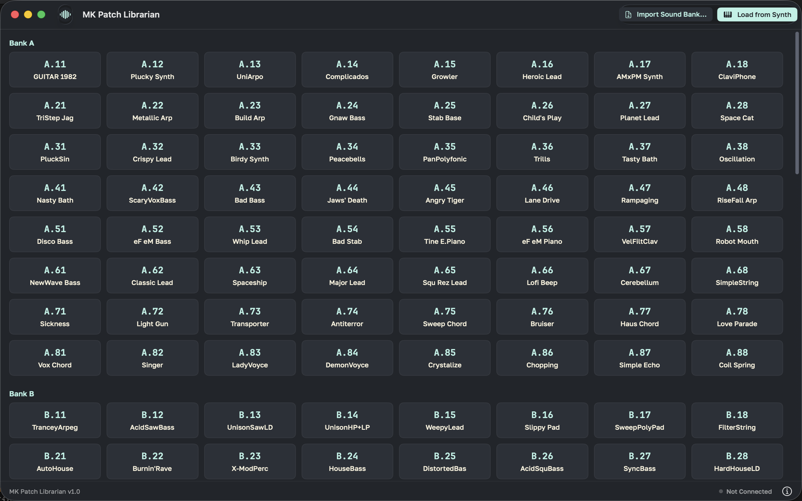
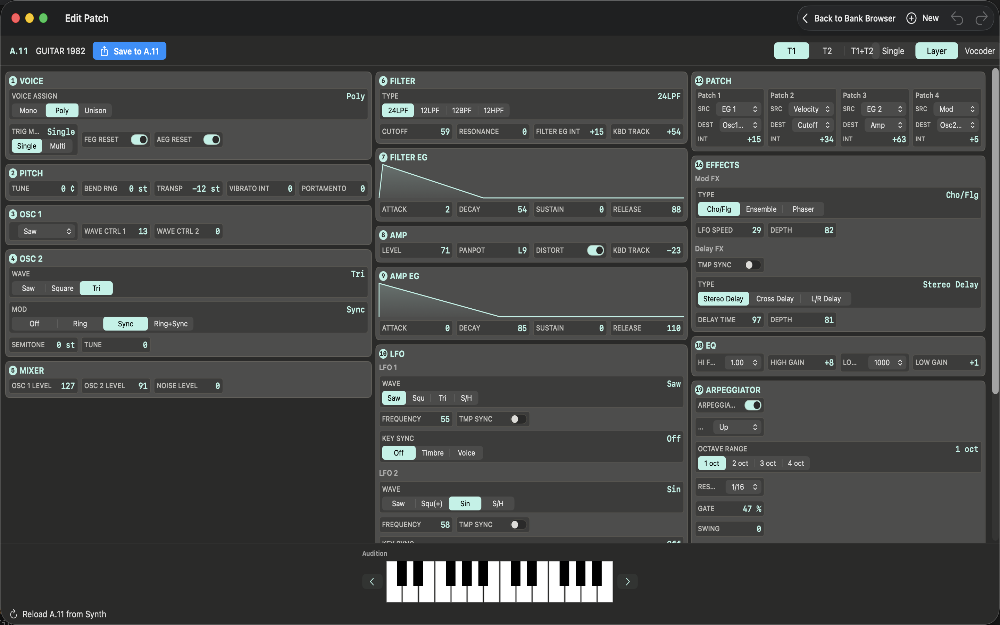
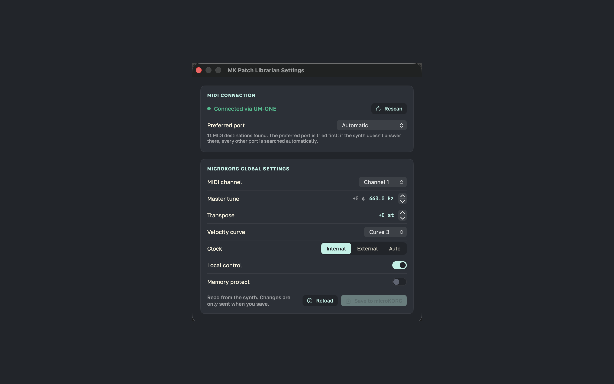

# MK Patch Librarian

A free, open-source editor/librarian for the Korg microKORG family over MIDI SysEx — browse banks, edit every parameter, import and selectively place programs, and audition a patch on real hardware before committing it to a slot.

## Features

- **Bank Browser**: grid view of all 128 A/B programs plus the C/D banks, with persistence across launches
- **Full Parameter Editor**: oscillators, filters, envelopes, LFOs, effects, arpeggiator, vocoder mode
- **SysEx Communication**: direct MIDI SysEx for load/save, with automatic retry on a missed device probe
- **Selective Import**: pick specific programs from a `.prg`/`.set`/`.syx` file and choose a destination slot for each, with conflict warnings before anything's overwritten
- **Audition Keyboard**: an on-screen keyboard that plays the currently-loaded patch on real hardware before you commit it
- **microKORG S Support**: full A/B/C/D addressing (128 + 64 + 64 slots)
- **Settings**: live MIDI connection status with an optional preferred port, plus the synth's own global settings (MIDI channel, master tune, transpose, velocity curve, clock, local control, memory protect), read from and written back to the hardware

Developed and tested against a microKORG S over a 5-pin DIN USB-MIDI interface (Roland UM-ONE). The original microKORG shares the same A/B program format but hasn't been hardware-tested.

## Screenshots

| Bank Browser | Patch Editor | Settings |
|---|---|---|
|  |  |  |

## Requirements

- macOS 14.0 or later
- Xcode with Swift 5.9+ (the full Xcode toolchain, not just Command Line Tools)
- A MIDI interface connected to the synth's 5-pin MIDI IN/OUT
- On the synth: MIDI channel 1, SysEx enabled, and write protect off before saving to it

## Building

If `xcode-select` points at Command Line Tools, set the developer dir first:

```bash
export DEVELOPER_DIR=/Applications/Xcode.app/Contents/Developer
```

```bash
swift build --package-path .
swift run MKPatchLibrarian
```

Or to build a real `.app` bundle (needed for the app to get a dock icon and become the active app). Quit any running copy first:

```bash
./bundle.sh
open "build/MK Patch Librarian.app"
```

Sandboxed, App Store–ready builds come from the Xcode project in `App/` — see [docs/APP_STORE.md](docs/APP_STORE.md).

## Usage

1. Connect your microKORG via a MIDI interface
2. Launch the app
3. Browse banks/programs in the grid view
4. Select a program to edit its parameters
5. Use the editor's Save/Reload buttons to transfer programs to/from the synth, or the on-screen keyboard to audition one first

## Architecture

### Core Layers

1. **PBAPI** — the MIDI/SysEx transport layer
   - `MIDIOutputPort.swift` — CoreMIDI session + raw message sending
   - `MIDIProtocol.swift` — SysEx request/reply handlers, Note On/Off
   - `DeviceLocator.swift` — finds the synth among connected MIDI endpoints
   - `KorgSysEx.swift` — microKORG SysEx message framing/decoding

2. **Models** — data structures for programs, banks, and slot addressing
   - `MicroKORGProgram.swift`, `VocoderProgram.swift` — the 254-byte program layout
   - `Bank.swift` — `ProgramSlot`, the A/B/C/D addressing scheme
   - `ProgramFileImport.swift` — `.prg`/`.set`/`.syx` file parsing

3. **UI** — SwiftUI interface
   - `BankBrowserView.swift` — grid browser, toolbar, import sheet
   - `EditorView.swift` — the parameter editor, plus the audition keyboard
   - `ImportProgramsView.swift` — selective import with per-program destination picking
   - Controllers (`UI/Controllers/`) own navigation and bank state

## Testing

```bash
swift test
```

Property/regression coverage spans SysEx framing, program parameter offsets, slot addressing, import merge logic, and the destination-picker's conflict detection. A handful of tests cross-check against local Korg factory `.syx` reference dumps that aren't part of this repository — set `MKSE_REFERENCE_DUMPS_DIR` to a directory containing them to run those; otherwise they skip automatically.

## Trademarks

Korg and microKORG are trademarks of Korg Inc. This project is independent and is not affiliated with, endorsed by, or sponsored by Korg.

## License

MIT License.
